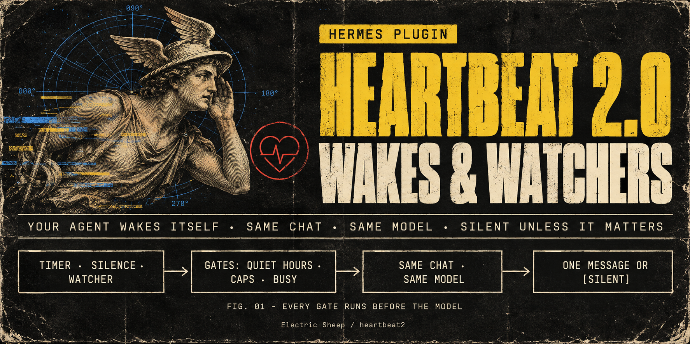

<p align="center"></p>

# HeartBeat 2.0

**Your Hermes agent can say "I'll check back at four", and then actually do it: in the same chat, on the same model, with everything it already knows.** It can watch a build, a log file, a process or a URL and speak up only when something changed. When there is nothing worth saying, it stays quiet.

- **You or your agent create the wakes and watchers.** A follow-up at a set time, a recurring check, a check-in after a long silence, or a deterministic watcher on a file, process, URL, read-only command or Hermes event. You arm them with `/pulse`; the agent arms them with its `pulse` tool.
- **Same conversation, same model.** A wake is a turn in the chat that armed it, on that chat's own model. There is no side model, separate cron session or subagent.
- **It catches its own pointless wakes.** A watcher costs no model call until something changes. A wake that keeps finding nothing slows down, suggests a watcher, then pauses and asks you once.
- **You own every guardrail.** Quiet hours, daily caps, the unanswered mute, intervals and lifetimes are plugin settings. The agent works inside them: it can only narrow its own wakes (shorter lifetime, fewer fires, slower pacing) or switch itself off, never widen a setting.

## What it feels like

**A follow-up that reads the room.**
> **You:** Remind me at 4 to send the Acme invoice.
> **Agent:** Will do. I'll check in at 16:00.
>
> *16:00.* **Agent:** It's 4. Did the Acme invoice go out? I can draft the email if that helps.

The wake runs inside your conversation. If you had written "sent it" at 15:10, the 16:00 turn would see that and stay silent. If the agent armed it with "cancel when I reply", any message from you cancels it outright.

**A watcher that speaks only when something changed.**
> **You:** Keep an eye on the nightly build and tell me if it breaks.
> **Agent:** Watching the latest nightly run with a read-only `gh run list` check every 10 minutes. I'll only look when the result changes, and only message you if it failed.
>
> *02:10, after 14 unchanged checks that cost no model turns:* **Agent:** The nightly build failed in `tests/test_api.py` (3 failures, all timeouts). Want me to dig in this morning?

During quiet hours that message waits until they end, unless you marked the watcher urgent and allowed urgent wakes through.

**A pointless wake that catches itself.** Say the agent set up an hourly "check the inbox" wake. After three empty checks it starts stretching the interval, and after six it pauses itself. The next time you talk:
> **Agent:** I paused "check the inbox": six checks in a row found nothing. Keep, slow, stop, or turn it into a watcher? (`/pulse keep|slow|stop|watch w_3f2a`)

**A check-in after a long silence** (off by default). When it is on, the agent checks in once after a silence (24 h by default) and says how to turn check-ins off. It doesn't check in again until you've talked.

## Why "2.0"
Heartbeats, as OpenClaw popularised them, made agents feel alive. They also produced a well-documented list of failures. We turned each one into a deterministic scenario in the benchmark suite:

| Heartbeat-1.0 failure | HeartBeat 2.0 |
|---|---|
| Stops silently after compaction, sleep or restart | The schedule and claims live in SQLite on wall-clock time. After a restart or sleep, missed fires collapse into one. |
| Duplicate or replayed deliveries | Each fire is a durable compare-and-set claim. Only one wake can be in flight per chat, and a wake is never injected into a busy chat. |
| Message floods (one loop resent 189×) | Daily caps on model turns and messages, spacing between wakes, a mute after unanswered messages, and an error ladder that ends in a pause. |
| "HEARTBEAT_OK" leaking into the chat | The model never types a sentinel. It calls `pulse respond notify=false`, and the plugin makes the turn silent. |
| Messages to the wrong chat or person | There is no destination parameter at all. A wake can only return to the chat that armed it, and only in DMs by default. |
| Most spend going to no-op ticks | Watchers decide without a model call. The no-op governor backs off, then pauses. |

Totals over 23 deterministic scenarios (B1 simulation driving the real engine; `python -m bench.run --baseline --gate`, source `77f0bd4`). The comparison arm is a naive heartbeat-1.0 emulator built from documented failure reports. It is **not** a measurement of OpenClaw itself.

| Across the suite | HeartBeat 2.0 | Naive heartbeat |
|---|---:|---:|
| Duplicate deliveries | 0 | 1 |
| Required fires missed | 0 | 9 |
| Sentinel text leaked into chat | 0 | 2 |
| Messages to the wrong chat | 0 | 2 |
| Most messages in one minute | 1 | 100 |
| Model turns | 42 | 504 |
| Model turns that found nothing | 15 | 78 |
| Estimated input tokens | 6,300,000 | 75,600,000 |

Every scenario and its hard bars are in [bench/README.md](bench/README.md); the full per-scenario table is regenerated per commit.

## How it works
```text
  you (/pulse) or the agent (pulse tool): what, when or what to watch, bounds
                                   │
                    durable schedule (SQLite in the profile)
                                   │
        time · silence · file · process · URL · command · Hermes event
                                   │
              nothing changed? ──► no model call, nothing sent
                                   │ due / changed / deadline
     gates: enabled · estop · paused · provider health · quiet hours ·
            unanswered mute · daily caps · busy · spacing · one in flight
                                   │
           one turn in the same chat, on the chat's own model
                                   │
                 pulse respond {outcome, notify, summary}
           notify=false ──► silent          notify=true ──► one short message
                                   │
          ledger + no-op governor (slow down → suggest a watcher → pause → ask once)
```

One poller per profile runs inside the messaging gateway and ticks every 5 seconds. A file lock guarantees only one poller even when several Hermes processes share the profile. Every fire is a durable claim with an attempt marker. An accepted turn that never starts is tried three times, and a refused injection backs off and is tried five times, before it is marked dead. A turn that started but never finished (a crash or restart) is recorded as interrupted. Hermes may auto-resume that wake turn, sometimes before heartbeat2's restart recovery has run; heartbeat2 keeps the replay silent either way, never counts it as a fire or delivery, and counts it as a model turn toward the daily cap.

## Install
Requires **Hermes ≥ 0.21.6** and Python ≥ 3.11 on macOS or Linux. v0.1 delivers into **messaging-gateway DMs**: Telegram, Discord, Slack, WhatsApp and the other gateway platforms.

```bash
hermes plugins install electricsheephq/heartbeat2 --enable
```

Then allow the plugin to start turns in your conversations. This is a Hermes core key, deliberately kept outside the plugin's own settings:

```yaml
plugins:
  entries:
    heartbeat2:
      allow_gateway_injection: true
```

Restart the messaging gateway and send `/pulse` in your DM. It shows:
- whether the scheduler is running;
- whether injection is allowed, with the exact YAML if it isn't;
- your local time and quiet hours;
- today's wakes, messages, cache counts and estimated cost (or token splits).

All other settings are in **Settings ▸ Plugins** in Hermes Desktop or in `config.yaml`.
At start a rejected setting falls back to its default; on a live change it keeps
its last good value, and your other changes still apply. `/pulse status` and
pulse tool results name the ignored setting.

## Using it
**You**, in the chat:

| Command | What it does |
|---|---|
| `/pulse` | Status: scheduler, consent, local time, quiet hours, today's counts, next due |
| `/pulse add in 2h check the deploy` | A one-off wake |
| `/pulse add every 1d at 09:00 plan my day` | A recurring wake at a fixed time |
| `/pulse add when silent 24h ask how the trip went` | Once per silence of that length |
| `/pulse list` · `/pulse why <id>` | Everything armed in this chat; why lists the last 10 trigger keys, states, reasons, matched/created and held-since times, and delivered yes/no |
| `/pulse ledger [7d]` | Totals over the range: fires, checks, model turns, messages, replies, cache/cost and token splits |
| `/pulse pause <id\|all> [for 3d]` · `resume` · `cancel` | Control one item or all of them |
| `/pulse quiet 22:00-07:30` · `quiet for 3h` · `quiet off` · `quiet default` | Quiet hours for this chat; `default` goes back to your settings |
| `/pulse ok <id>` | Approve a wake the agent proposed (when *Agent can arm wakes* is `ask_first`) |
| `/pulse keep\|slow\|stop\|watch <id>` | Answer the governor's card for a paused wake (`watch` pauses it and asks your agent to turn it into a watcher; the next watcher-only trigger or schedule conversion keeps it yours). Any other agent edit of the trigger, timing or note makes it the agent's: it gets the agent's interval floor and cache snap, and the unanswered mute applies. |
| `/pulse off` · `/pulse on` | Turn wakes off or back on for this chat. Only you can turn them back on. |

`/pulse` is a control panel, not conversation. Using it never counts as replying to the agent.

**Your agent** gets one tool, `pulse` (`create · list · update · pause · resume · cancel · respond · off`), and the bundled `heartbeat2-usage` skill. The skill teaches it to:
- arm a wake only for a named open loop, never just to stay in touch;
- prefer a watcher to a timer whenever a deterministic check can tell "changed";
- answer every wake with `respond`: `outcome` (no_change · progress · done · blocked · needs_attention), `notify`, a one-line `summary`, and optionally `next_check` and `scratch` notes for its next wake.

Watchers available to the agent:

| Watcher | Fires when |
|---|---|
| `file` | The file changes, or an appended line matches a pattern |
| `process` | A process exits (PID reuse is detected) |
| `url` | A GET response changes, or a pattern appears (10 s hard deadline, 256 KB cap) |
| `command` | A read-only allowlisted command's output changes, it succeeds or fails, or it prints `{"fire": true, …}` |
| Hermes events | A kanban task completes or blocks, a worker exits, a subagent finishes, the API errors, or someone reacts to or edits a message |

Hermes events are selected by `trigger.kind`: `kanban_completed`, `kanban_blocked`, `kanban_worker_exited`, `subagent_done`, `api_error`, `reaction` (with an optional `emojis` filter) and `message_edited`.

Any watcher can carry a `deadline`, so "nothing happened by Friday" fires once, too.

## Settings
These live under `plugins.entries.heartbeat2.settings` and appear in **Settings ▸ Plugins**. The agent's tool can't change them. When a request goes past a bound, the tool tells the agent exactly what it clamped.

| Setting | Key | Default | What it does |
|---|---|---|---|
| Enabled | `enabled` | on | Master switch for wakes and watchers in this profile. |
| Agent can arm wakes | `agent_can_create` | `yes` | yes · ask_first (the agent's wakes wait for `/pulse ok <id>`) · no |
| Direct messages only | `dm_only` | on | Refuse group chats. Unknown chat types are refused too. |
| Time zone | `timezone` | (blank) | IANA name such as Europe/Paris. Blank uses the profile's time zone. |
| Quiet hours | `quiet_hours` | `22:00-08:00` | HH:MM-HH:MM, may cross midnight; blank for none. Due one-shots wait until the end; recurring ticks inside are skipped. |
| Urgent wakes ignore quiet hours | `quiet_hours_urgent` | off | Let wakes marked urgent through quiet hours. |
| Wake turns per day | `max_model_wakes_per_day` | 24 | Per chat, local day. Each wake turn is a full model turn. |
| Unprompted messages per day | `max_messages_per_day` | 6 | Per chat, local day. |
| Unanswered messages before mute | `max_unanswered` | 2 | Wakes you armed always fire; agent watchers wait for your reply; agent reminders are dropped. Agent edits revoke the owner exemption, except a watcher-only conversion you requested with `/pulse watch`. |
| Shortest repeat (minutes) | `min_interval_minutes` | 15 | Floor for every recurring time wake. |
| Shortest agent timer without a watcher (minutes) | `agent_ungated_floor_minutes` | 55 | Floor for recurring timers the agent arms without a watcher. |
| Minutes between wake turns | `wake_spacing_minutes` | 10 | Per chat. |
| Fastest watcher check (seconds) | `probe_floor_seconds` | 60 | Watchers never check more often than this. |
| Active wakes per chat | `max_active` | 10 | Also capped at 50 across the profile. |
| Longest lifetime (days) | `max_lifetime_days` | 14 | Every wake expires by then; agent recurring wakes default to 7 days. |
| Check in after a long silence | `owner_silent_checkin` | off | Off by default. One check-in per silence, with how to turn it off. |
| Silence before a check-in (hours) | `checkin_after_hours` | 24 | Doubles for the next silence if a check-in is ignored. |
| Wake-from-wake depth | `max_rearm_chain` | 2 | How many wakes deep a chain armed inside wake turns may go; a message from you resets it. |
| Empty fires before slowing down | `noop_slowdown_after` | 3 | A recurring wake that keeps finding nothing doubles its interval after this many. |
| Slow-down multiplier | `noop_backoff_factor` | 2 | How much each slow-down stretches the interval. |
| Longest slowed interval (hours) | `noop_max_backoff_hours` | 24 | Slowing down stops at this interval. |
| Empty fires before suggesting a watcher | `suggest_gate_after` | 4 | The wake text suggests turning the timer into a watcher. |
| Empty fires before pausing | `noop_pause_after` | 6 | Pauses the wake and asks you once: keep, slow, stop or watch. |
| Ignored messages before pausing | `ignored_pause_after` | 3 | Delivered messages with no reply in the engagement window. |
| Errors in a row before pausing | `error_pause_after` | 5 | Errors in a row before pausing. |
| Reply window (hours) | `engagement_window_hours` | 6 | A reply within this window counts a delivered message as useful. |
| Catch-up window (hours) | `catch_up_hours` | 6 | A one-shot more than this late after downtime is reported as missed instead of firing. |
| Allowed watcher commands | `probe_commands` | `gh pr view, gh pr checks, gh run view, gh run list, git ls-remote, git status, git log` | Comma-separated argv prefixes for command watchers. Blank disables command watchers. |
| Silence check-ins | `source_silence` | on | Silence check-ins. |
| Process watchers | `source_process` | on | Process watchers. |
| File watchers | `source_file` | on | File watchers. |
| URL watchers | `source_url` | on | URL watchers. |
| Let URL watchers reach private and local addresses | `url_allow_private` | off | Allow private and local URL targets (loopback, private ranges). Cloud metadata and the whole IPv4 link-local range 169.254.0.0/16 stay blocked, as Hermes treats that range as metadata. |
| Command watchers | `source_command` | on | Command watchers. |
| Hermes event watchers | `source_events` | on | Kanban, subagent, API error and reaction events. |
| Tell the agent what's armed | `presence_line` | on | One short context line on your turns while something is armed. |
| Ledger history (days) | `ledger_days` | 30 | Ledger history (days). |

## Guardrails, briefly
Every guardrail is configurable:
- Recurring timers repeat at most every 15 minutes, or every 55 minutes when the agent arms one without a watcher. Watchers check at most once a minute.
- Every wake expires after 14 days at most.
- Daily caps hold watchers until capacity frees, including on a new local day; your unedited one-shot reminders bypass both caps.
- After 2 unanswered messages, agent watchers hold until you write; agent timers and built-in check-ins drop their occurrence. Wakes you armed still fire unless the agent edited their trigger, timing or note; a watcher-only conversion you requested with `/pulse watch` keeps owner status. Held matches merge, keeping the latest payload; pauses preserve them and expiry is visible in `/pulse why`.
- A wake turn that carries untrusted data, such as a log line or a web page, cannot arm new recurring work.
- Hermes' emergency stop halts every wake.
- `/pulse off` stops everything in that chat, and only you can turn it back on.

## Cost
A wake turn is an ordinary model turn in that conversation. It is billed like a message, and its size is your conversation's context size: on a long-running agent that can be 100–200k input tokens per wake. Watchers, gates and skipped wakes cost nothing. `/pulse status` and `/pulse ledger` show warm/cold wake counts and estimated cost when priced, otherwise the in/cached/written/out split. The ledger also counts `no_verdict` turns. Start with watchers and long intervals.

## Prompt cache
Claude marker routes use Hermes' 5m/1h/auto setting; GPT-5.6+ and GPT-6.x on OpenAI API routes use 30m.
The Codex OAuth route is reported as unknown until learned.
Other routes learn a conservative TTL only after both warm and cold gaps are observed.
Agent recurring intervals near the TTL snap below it with downward jitter, respecting floors.
Owner wakes, cron and anchored repeats retain their timing. Cache lines show the effect and warm interval.

## Security and privacy
Disclosure — wakes and watchers run full turns on the conversation's own model, billed like any message; command watchers run allowlisted read-only commands without an approval prompt; URL watchers make the GET requests you configured; state stays in the profile's plugin-data; no telemetry. Command environments use Hermes' sanitizer on an allowlisted base and carry no provider, bot or GitHub tokens; gh uses its own hosts.yml or keyring. URL watchers always block cloud metadata, and block private/local addresses unless `url_allow_private` is enabled, checking every hop at connect time. File watchers honor Hermes read blocks at arm/update and every check, including rotation. Helpers run in the watcher's profile scope.

Command watchers:
- use an allowlisted environment that does not pass proxy or custom-CA variables yet;
- run only argv prefixes from your allowlist. The default is `gh pr view/checks`, `gh run view/list`, `git ls-remote/status/log`;
- run with no shell and no terminal;
- refuse output, config, editor, browser and mutating flags and verbs, including gh `--jq`/`-q` and `--template`/`-t`;
- have the whole process group killed after 30 seconds.

The argv guard is not a sandbox: only allow programs you trust to be read-only. URL watchers refuse credentials in the URL and send no cookies, auth headers or proxy settings. Wake turns keep the conversation's normal tools and permissions. Full threat model and limits: [SECURITY.md](SECURITY.md).

The default command allowlist still permits `gh -R HOST/...` and `git ls-remote <url>` to reach any host the machine can reach; v0.1.1 does not change this exception.

## Roadmap

- [v0.1.1: catalog listing conditions](https://github.com/electricsheephq/heartbeat2/milestone/5)
- [v0.1.2: no silent loss + cache-aware timing](https://github.com/electricsheephq/heartbeat2/milestone/4)
- [v0.2: real-gateway proof, behaviour bench, cost](https://github.com/electricsheephq/heartbeat2/milestone/2)
- [v0.3: more triggers + learning](https://github.com/electricsheephq/heartbeat2/milestone/3)
- [Research / blocked](https://github.com/electricsheephq/heartbeat2/milestone/6)

## Compatibility and known issues
- **v0.1 delivers only to messaging-gateway DMs.** It refuses to arm wakes from the CLI, TUI, Desktop, the API server or cron: a CLI wake would interrupt your turn, and TUI/Desktop have no silence filter for injected turns yet. Desktop and TUI wakes are planned for v0.3 ([#8](https://github.com/electricsheephq/heartbeat2/issues/8)), once Hermes core supports them.
- **A wake turn that fails at the provider** (quota, auth, outage) shows Hermes's own failure notice in the chat. The plugin cannot suppress it ([NousResearch/hermes-agent#136749](https://github.com/NousResearch/hermes-agent/issues/136749)). HeartBeat 2.0 settles that wake, then holds every wake back (5 min → 15 min → 1 h → 4 h) until a model call on the profile succeeds again. A long outage therefore costs one notice per backoff step, not one per wake.
- **Silence covers the final reply.** `notify=false` keeps the agent's reply out of the chat. On platforms that show tool progress by default (Discord; WhatsApp and Matrix show new tools), each wake turn still posts a progress bubble. Telegram and Slack hide tool progress by default. To keep wakes fully silent there, set `display.platforms.<platform>.tool_progress: off`. A quiet-injection option is requested upstream ([NousResearch/hermes-agent#136825](https://github.com/NousResearch/hermes-agent/issues/136825)).
- **Messages sent while the agent is busy.** On Signal/SimpleX, a message that waits in Hermes' queue while a turn is running (a photo, or any message when `busy_input_mode` is `queue`) reaches the agent without a message id, so HeartBeat 2.0 does not count it as your reply. The unanswered mute and the silence check-in treat you as silent until your next message. Text you send mid-turn in the default mode is counted. With the Codex app-server runtime, its native steer (text you send into a running wake turn) is not detected, so a wake that decides to stay silent can leave that steer unanswered.
- **Memory providers see wake text as a user turn** ([NousResearch/hermes-agent#130622](https://github.com/NousResearch/hermes-agent/issues/130622)). An external memory provider may store a wake's instructions as if you had written them.
- **Kanban watchers only see tasks whose worker runs in this profile.** A task assigned to another profile completes in that profile's worker, out of sight.
- **`codex_app_server` turns drop per-turn context**, so the presence line and governor card don't reach the model on that provider path. Wakes still fire, and silence still works.
- **File watchers poll.** A truncate-and-regrow or a replacement that happens entirely between two checks can be missed. Reading catches up within 4 MB per check, and lines over 256 KB are skipped.
- **Notes, scratch, summaries and event payloads are stored in plaintext** in `<profile>/plugin-data/heartbeat2/pulse.db`. Don't watch credential files.
- **Live proof so far:** one profile (Telegram DM, GLM model) covered a delivered follow-up, a silent verdict and survival across a gateway restart. The benchmark suite is a deterministic simulation of the engine, not a measurement of live delivery.

## How it compares
A workflow comparison, not a measured parity claim.

| Option | What it is | When to pick it instead |
|---|---|---|
| **HeartBeat 2.0** | Wakes and watchers that you or the agent create. They run in the live DM on its own model, with deterministic watchers, owner-set bounds, structured silence and a no-op governor. | |
| Hermes `/heartbeat` (core) | One recurring instruction for the current session, with core persistence and idle admission. Silence is a bare marker. | You want one periodic nudge and nothing else. |
| Hermes `/loop` | Repeats an instruction in the active interactive session. | You are working at the keyboard, not waiting on something. |
| Hermes cron | Scheduled jobs, each in a fresh session with no conversation history, delivering a report. A `no_agent` job's script can print `{"wakeAgent": false}` to stay silent. HeartBeat 2.0 borrows that idea for command watchers but fires inside the live conversation. | Independent scheduled tasks that don't need the conversation. |
| [hermes-cron](https://github.com/itpartypattaya/hermes-cron) | An operating skill and doctor for core cron. | Complementary: it makes cron easier, it isn't a scheduler. |
| [jev-cron-gate](https://github.com/superlowburn/hermes-jev-cron-gate) | A pre-run gate for core cron: a side model answers yes or no on whether a run is pointless, then the run happens in a fresh cron session. HeartBeat 2.0's gates are deterministic, with no side model. | You already run cron jobs and want to skip pointless ones. |
| [Alan's Way](https://github.com/capthvnsen/alans-way-agents) | An idle check-in for one bound Telegram DM after 2 h of quiet (08:00–22:00), which may take one safe step, bundled with a desktop workspace app and services. It uses the same injection seam. | You want that whole workspace and a single fixed check-in rhythm. |
| OpenClaw heartbeat | A periodic heartbeat inside the main conversation. HeartBeat 2.0 was designed against its documented failure reports; it is not a port, and it makes no claim about OpenClaw's current behaviour. | You run OpenClaw. |

## Development
```bash
python -m pytest -q                                   # unit tests (network denied)
HERMES_HOME=$(mktemp -d) HERMES_DISABLE_LAZY_INSTALLS=1 HEARTBEAT2_REQUIRE_HERMES=1 \
  PYTHONPATH=/path/to/hermes-agent python -m pytest tests/integration -q   # real Hermes loader
python -m bench.run --baseline --gate --out bench-out  # simulation benchmark + gate
```

CI runs the unit tests on Ubuntu and macOS with Python 3.11, 3.13 and 3.14. It also runs the real-loader integration test against Hermes v0.21.6 and a pinned main commit. A mutant test applies known-bad changes to a temporary copy of the engine (replayed slots, claim CAS off, flock off, estop off, raw transform, cancel-on-reply off and more), and checks that the benchmark gate fails for each one. That keeps the gate from becoming a tautology.

Credits: claim, refund and coalescing semantics follow Hermes core `/heartbeat`. Fingerprinting follows Hermes' cron monitor, and estop and busy ordering follow the gateway. OpenClaw's public issue reports shaped the benchmark scenarios.

Built for [Hermes Agent](https://github.com/NousResearch/hermes-agent) by Electric Sheep. Apache-2.0.

Known issues: provider-exhaustion settlement (#27) remains blocked by [NousResearch/hermes-agent#137357](https://github.com/NousResearch/hermes-agent/issues/137357).
