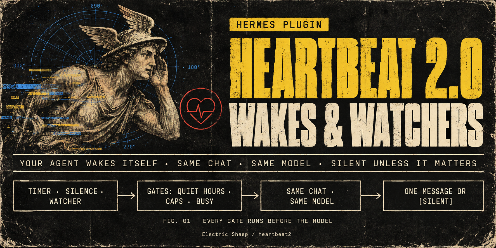
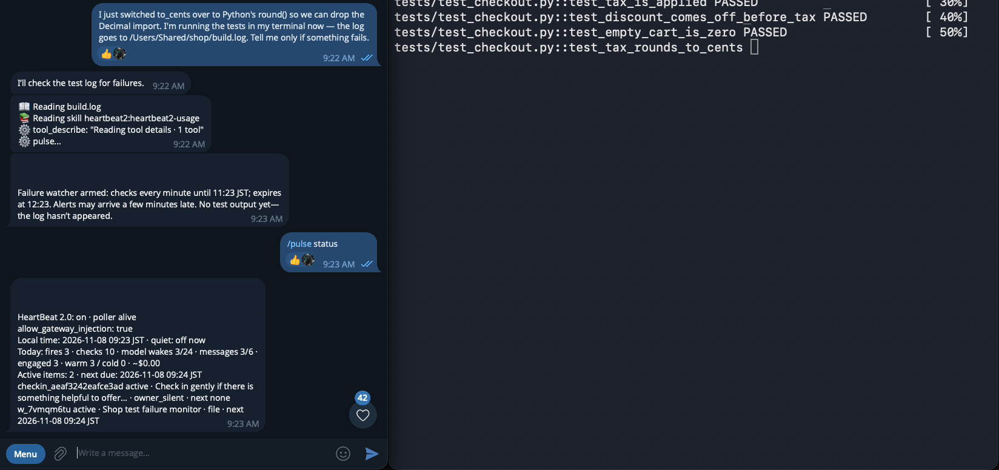
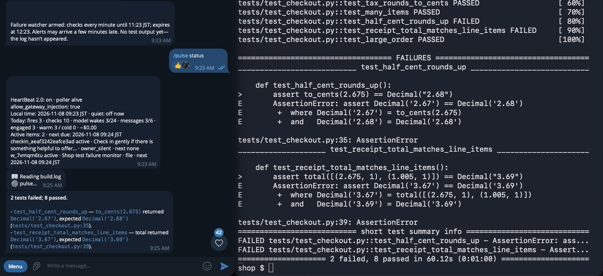
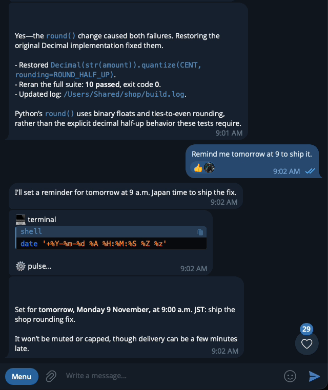
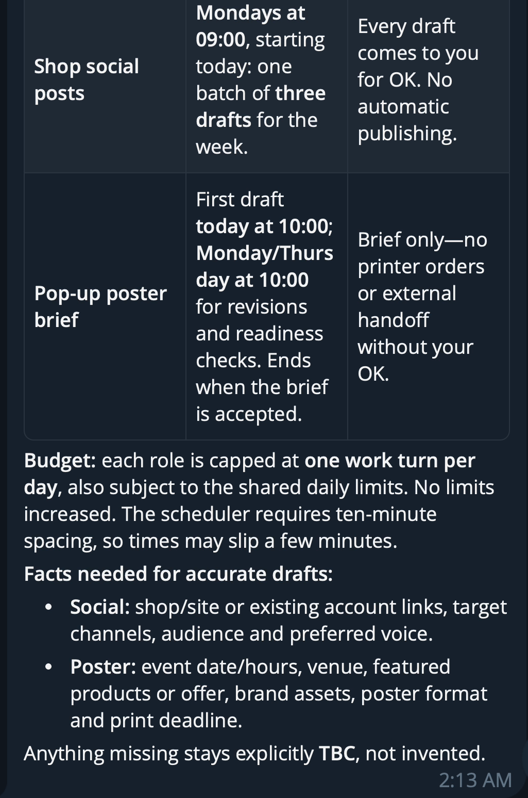
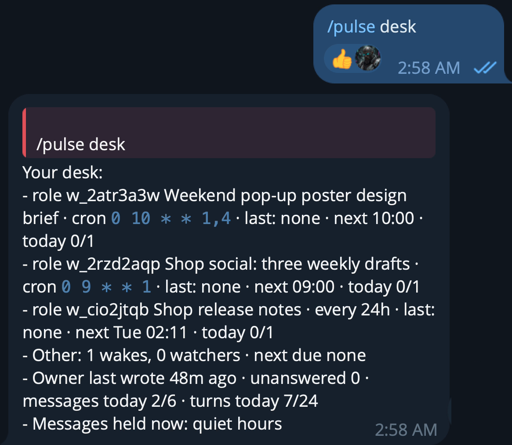

<p align="center"></p>

# HeartBeat 2.0

**Give your Hermes agent a working life between messages: wakes, watchers and roles, within daily turn and message caps.**

No model runs until there's work: plain code checks every wake and watcher, and the agent gets a turn only when something is due or a watcher's condition is met. `/pulse` shows what's next; `/pulse why <id>` lists an item's recent triggers with their states and reasons.

▶ **[Watch the demo](https://x.com/ElectricSheepIO/status/2119811070089138455)**

https://github.com/user-attachments/assets/135d08af-36e8-46d5-bc7f-7ac5e5326c03

[](https://github.com/electricsheephq/heartbeat2/releases/latest) [](https://github.com/electricsheephq/heartbeat2/blob/main/LICENSE) [](https://github.com/NousResearch/hermes-agent) [](https://github.com/electricsheephq/heartbeat2/actions/workflows/ci.yml)

```bash
hermes plugins install electricsheephq/heartbeat2 --enable
```

It needs Hermes ≥ 0.21.6 with a messaging gateway (Telegram, Discord, Slack, WhatsApp and the other gateway platforms) on macOS or Linux, with Python ≥ 3.11. No API keys, and nothing to install beyond what Hermes already ships. Next, allow it to start turns and try it:

## Try it

1. **Allow it to start turns.** Add this Hermes core key to your profile's `config.yaml` (it is kept outside the plugin's own settings on purpose), restart the messaging gateway, and send `/pulse` in your DM. It should say injection is allowed; if not, it shows the exact YAML to add.
   ```yaml
   plugins:
     entries:
       heartbeat2:
         allow_gateway_injection: true
   ```
2. **Ask for something soon.** In the same DM, write: "Remind me in 5 minutes to stretch." The agent arms a one-time reminder and replies with a one-line receipt saying when it will really fire.
3. **It writes first.** Five minutes later the reminder arrives in that chat, from the agent, with no message from you in between. `/pulse list` and `/pulse why <id>` show what happened. During quiet hours (22:00–08:00 by default) a reminder waits until they end.

Next, hand it a role and watch its desk ([Your first role](#your-first-role)), or have it watch something without a timer ([What it feels like](#what-it-feels-like)).

**Contents:** [What it does](#what-it-does) · [See it work](#see-it-work) · [What it feels like](#what-it-feels-like) · [Why "2.0"](#why-20) · [How it works](#how-it-works) · [Setup](#setup) · [Using it](#using-it) · [Settings](#settings) · [Guardrails](#guardrails-briefly) · [Cost](#cost) · [Security and privacy](#security-and-privacy) · [Roadmap](#roadmap) · [Known issues](#compatibility-and-known-issues) · [Troubleshooting](#troubleshooting) · [How it compares](#how-it-compares) · [Development](#development) · [Links](#links)

## What it does

Put your agent in charge of something and it keeps working on it on its own time: in the same chat, on the same model, with everything it already knows, inside the budgets you set. It can watch a build, a log, a process or a URL and speak up only when something changed. When there's nothing worth saying, it keeps working quietly or rests.

- **Roles it owns.** "You're in charge of the release notes." A role is a standing responsibility with a charter, a notebook the agent keeps between turns, and a rhythm the agent sets itself. It doesn't expire on a timer. You can hand one over, or the agent can take one on and tell you.
- **Its own time.** Turn on own time and the agent gets regular turns with no assigned task. It looks at its desk (its roles, what's due, what it noticed, what budget is left) and decides: work on a role, follow something up, set up a watcher, tidy its notes or memory, or rest.
- **Follow-ups and watchers.** A follow-up at a set time, a recurring check, a check-in after a long silence, or a deterministic watcher on a file, process, URL, read-only command or Hermes event. A watcher costs no model call until its condition is met.
- **Same conversation, same model.** Every wake is a turn in the chat it belongs to, on that chat's own model. There is no side model, separate cron session or subagent.
- **Quiet work counts.** A turn that researches, writes or prepares something without messaging you is real progress. Only wakes that keep finding nothing to do slow down, then pause and ask you once.
- **You set the budgets.** Turns per day, an optional daily priced-spend limit, turns per role, messages per day, the unanswered mute and quiet hours are your settings. They hold back messages and spending, not initiative: while you're away or asleep the agent can keep working, and it tells you what matters when you're back. That work still uses turns: the agent's recurring work, roles and own time keep running (and billing) under the mute and quiet hours. Turn limits and the priced-spend check apply before each turn; the spend limit cannot stop a turn already running, and unpriced calls are not counted. Roles and own time don't expire on a timer. The agent can tighten its own limits but never widen yours.

## See it work

One real run in a Telegram DM, captured as it happened (only reply-quote headers and two internal tool names are painted out). The owner switches a rounding function, starts the tests in a terminal, and asks the agent to speak up only if something fails.

**1. Ask once.** The agent arms a file watcher on the test log and says what it will do. Mid-run, `/pulse status` shows the watcher checking and no new messages.



**2. It writes first.** Two tests fail. About a minute later the agent posts the failures and the wrong values, with no message from the owner in between.



**3. Same conversation.** Asked "Is that my round() change?", it answers from the chat it already has, restores the Decimal version and reruns the suite: all 10 tests pass.



A second real run on the same profile shows roles and the desk (the reply-quote header is painted out).

**4. Hand it a role.** Asked to own the shop's release notes, a weekly batch of social drafts and a pop-up poster brief, the agent sets up three roles and sends a receipt. For each one it gives the rhythm, what it will and won't do without an OK, and a budget of one work turn a day. It also lists the facts it still needs, and anything missing stays TBC instead of being invented. (The release-notes row is above this crop.)



**5. Its desk.** `/pulse desk` shows the view the agent gets at the start of every role turn: each role's rhythm, last result and next turn, the day's messages and turns against your limits, and why messages are held right now. (A long desk lists the most recently updated roles and counts the rest.) Here it is quiet hours: the roles' turns still run, but their replies aren't sent. When you're back, the agent gets a short list of what it wanted to tell you and passes on what still matters.



## What it feels like

**A follow-up that reads the room.**
> **You:** Remind me at 4 to send the Acme invoice.
> **Agent:** Will do. I'll check in at 16:00.
>
> *16:00.* **Agent:** It's 4. Did the Acme invoice go out? I can draft the email if that helps.

The wake runs inside your conversation. If you had written "sent it" at 15:10, the 16:00 turn would see that and stay silent. If the agent armed it with "cancel when I reply", any message from you cancels it outright.

**A watcher that speaks only when something changed.**
> **You:** Keep an eye on the nightly build and tell me if it breaks.
> **Agent:** Watching the latest nightly run with a read-only `gh run list` check every 10 minutes. I'll only look when the result changes, and only message you if it failed.
>
> *02:10, after 14 unchanged checks that cost no model turns:* **Agent:** The nightly build failed in `tests/test_api.py` (3 failures, all timeouts). Want me to dig in this morning?

During quiet hours that message waits until they end, unless you marked the watcher urgent and allowed urgent wakes through.

**A pointless wake that catches itself.** Say the agent set up an hourly "check the inbox" wake. After three empty checks it starts stretching the interval, and after six it pauses itself. The next time you talk:
> **Agent:** I paused "check the inbox": six checks in a row found nothing. Keep, slow, stop, or turn it into a watcher? (`/pulse keep|slow|stop|watch w_3f2a`)

**A check-in after a long silence** (off by default). When it is on, the agent checks in once after a silence (24 h by default) and says how to turn check-ins off. It doesn't check in again until you've talked.

## Why "2.0"
Heartbeats, as OpenClaw popularised them, made agents feel alive. They also produced a well-documented list of failures. We turned each one into a deterministic scenario in the benchmark suite:

| Heartbeat-1.0 failure | HeartBeat 2.0 |
|---|---|
| Stops silently after compaction, sleep or restart | The schedule and claims live in SQLite on wall-clock time. After a restart or sleep, missed fires collapse into one. |
| Duplicate or replayed deliveries | Each fire is a durable compare-and-set claim. Only one wake can be in flight per chat, and a wake is never injected into a busy chat. |
| Message floods (one loop resent 189×) | Daily caps on model turns and messages, spacing between wakes, a mute after unanswered messages, and an error ladder that ends in a pause. |
| "HEARTBEAT_OK" leaking into the chat | The model never types a sentinel. It calls `pulse respond notify=false`, and the plugin makes the turn silent. |
| Messages to the wrong chat or person | There is no destination parameter at all. A wake can only return to the chat that armed it, and only in DMs by default. |
| Most spend going to no-op ticks | Watchers decide without a model call. The no-op governor backs off, then pauses. |

Totals over 34 deterministic scenarios (B1 simulation driving the real engine; `python -m bench.run --baseline --gate`, source `ca12767`, v0.1.14 engine; the gate report records content digests). The comparison arm is a naive heartbeat-1.0 emulator built from documented failure reports. It is **not** a measurement of OpenClaw itself.

| Across the suite | HeartBeat 2.0 | Naive heartbeat |
|---|---:|---:|
| Duplicate deliveries | 0 | 1 |
| Required fires missed | 0 | 27 |
| Sentinel text leaked into chat | 0 | 2 |
| Messages to the wrong chat | 0 | 6 |
| Most messages in one minute | 1 | 100 |
| Model turns | 110 | 588 |
| Model turns that found nothing | 15 | 82 |
| Estimated input tokens (total; calls × context) | 33,000,000 | 176,400,000 |
| Estimated cache read tokens | 25,950,000 | 116,550,000 |
| Estimated cache write tokens | 7,050,000 | 59,850,000 |
| Estimated output tokens | 33,000 | 176,400 |

Every scenario and its hard bars are in [bench/README.md](bench/README.md); the full per-scenario table is regenerated per commit.

## How it works
```text
  you (/pulse) or the agent (pulse tool): what, when or what to watch, bounds
                                   │
                    durable schedule (SQLite in the profile)
                                   │
        time · silence · file · process · URL · command · Hermes event
                                   │
              nothing changed? ──► no model call, nothing sent
                                   │ due / changed / deadline
     gates: enabled · estop · paused · provider health · quiet hours ·
            unanswered mute · daily caps · busy · spacing · one in flight
                                   │
           one turn in the same chat, on the chat's own model
                                   │
                 pulse respond {outcome, notify, summary}
           notify=false ──► silent          notify=true ──► one short message
                                   │
          ledger + no-op governor (slow down → suggest a watcher → pause → ask once)
```

One poller per profile runs inside the messaging gateway that serves that profile and ticks every 5 seconds. Hermes loads every profile's plugins when a gateway starts; a gateway that does not serve a profile leaves that profile's schedule alone and delivers nothing for it. A file lock guarantees only one poller even when several Hermes processes share the profile. Every fire is a durable claim with an attempt marker. An accepted turn that never starts is tried three times, and a refused injection backs off and is tried five times, before it is marked dead. A turn that started but never finished (a crash or restart) is recorded as interrupted. Hermes may auto-resume that wake turn, sometimes before heartbeat2's restart recovery has run; heartbeat2 keeps the replay silent either way, never counts it as a fire or delivery, and counts it as a model turn toward the daily cap.

## Setup
Requires **Hermes ≥ 0.21.6** and Python ≥ 3.11 on macOS or Linux. HeartBeat 2.0 delivers into **messaging-gateway DMs** (and group or topic chats when `dm_only` is off): Telegram, Discord, Slack, WhatsApp and the other gateway platforms.

Install with the command at the top, add the `allow_gateway_injection` key shown in [Try it](#try-it), and restart the messaging gateway. Then send `/pulse` in your DM. It shows:
- whether the scheduler is running;
- whether injection is allowed, with the exact YAML if it isn't;
- your local time and quiet hours;
- today's wakes, messages, cache counts and estimated cost (or token splits).

### Your first role

A role shows its first results over a few hours, because it spreads its turns across the day. Start one once [Try it](#try-it) works:

1. **Hand it a role.** In your DM, for example: "You're in charge of my reading list. Summarise anything new between my messages, a few turns a day." The agent sets up the role and sends a receipt with its rhythm, what it will and won't do, and its daily budget. You can also set one up yourself with `/pulse role self <charter>` or `/pulse role every 1d at 09:00 <charter>`.
2. **Let it work.** A role without a fixed time starts with its turns spread across the day by its budget: at the default 6 turns, about one every four hours. Quiet hours and the message limits hold its messages, not its work.
3. **Look at its desk.** `/pulse desk` shows each role's last result and next turn, and today's messages, turns and cost against your limits. The agent sees the same desk.
4. **Adjust or stop it.** `/pulse budget <id> 2/day` sets a role's daily turns; the agent can go under your number but never over it, and only this command raises it. A new budget changes how many turns the role takes a day, not how often they come: to spread them out, ask the agent to change its rhythm. `/pulse pause <id>` or `/pulse cancel <id>` stops one role, and `/pulse off` stops everything in the chat.

Optional: set **Own time** (`own_time_hours`, for example 6) to give the agent regular turns with no assigned task. On Discord, WhatsApp or Matrix, set `display.platforms.<platform>.tool_progress: off` so silent turns don't post progress bubbles.

All other settings are in **Settings ▸ Plugins** in Hermes Desktop or in `config.yaml`.
At start a rejected setting falls back to its default; on a live change it keeps
its last good value, and your other changes still apply. `/pulse status` and
pulse tool results name the ignored setting.

## Using it
**You**, in the chat:

| Command | What it does |
|---|---|
| `/pulse` | Status: scheduler, consent, local time, quiet hours, today's counts, next due |
| `/pulse add in 2h check the deploy` | A one-off wake |
| `/pulse add every 1d at 09:00 plan my day` | A recurring wake at a fixed time |
| `/pulse add when silent 24h ask how the trip went` | Once per silence of that length |
| `/pulse role self <charter>` · `/pulse role every 1d at 09:00 <charter>` | Hand the agent a role: a standing responsibility with a notebook and a daily turn budget. `self` lets the agent pace it. |
| `/pulse desk` | The agent's desk: each role's rhythm, last result and next turn; today's messages, turns and cost against your limits; and why messages are held, if they are. Finished roles stay on it until you've written in the chat (for up to 24 hours), and it counts results held for you. |
| `/pulse budget <id> 3/day` | Set a role's daily turns. The agent can go under your number but never over it; only this command raises it. |
| `/pulse list` · `/pulse why <id>` | Active, proposed and paused items plus the 10 most recently created finished ones; `/pulse list all` shows everything. Why lists the last 10 trigger keys, states, reasons, matched/created and held-since times, and delivered yes/no |
| `/pulse run <id>` | Queue one turn of a recurring wake or role now; keeps every usual check, including busy chat, quiet hours and daily caps, and counts as one of its fires. Watchers, one-time reminders, the quiet check-in and own time fire on their own: preview those with `/pulse test` |
| `/pulse test <id>` | Preview the checks, next fire, cache and wake text; sends nothing, calls no model and changes nothing |
| `/pulse ledger [7d]` | Totals over the range: fires, checks, model turns, messages, replies, cache/cost and token splits |
| `/pulse pause <id\|all> [for 3d]` · `resume` · `cancel` | Control one item or all of them |
| `/pulse quiet 22:00-07:30` · `quiet for 3h` · `quiet off` · `quiet default` | Quiet hours for this chat; `default` goes back to your settings |
| `/pulse ok <id>` | Approve a wake the agent proposed (when *Agent can arm wakes* is `ask_first`) |
| `/pulse keep\|slow\|stop\|watch <id>` | Answer the governor's card for a paused wake (`watch` pauses it and asks your agent to turn it into a watcher; the next watcher-only trigger or schedule conversion keeps it yours). Any other agent edit of the trigger, timing or note makes it the agent's: it gets the agent's interval floor and cache snap, and the unanswered mute applies. |
| `/pulse off` · `/pulse on` | Turn wakes off or back on for this chat. Only you can turn them back on. |

`/pulse` is a control panel, not conversation. Using it never counts as replying to the agent. Anything else you send counts as a reply, including a reaction or an edit on platforms that report them: it resets the unanswered mute and cancels wakes armed to stop when you reply. A reaction or edit counts only when its chat maps to one HeartBeat session; in a chat shared by several sessions (for example DM threads or topics) it is ignored. The other exceptions are listed under known issues: a message queued while the agent is busy on Signal or SimpleX, and a Codex app-server steer.

**Your agent** gets one tool, `pulse` (`create · list · desk · update · pause · resume · cancel · respond · off`), and the bundled `heartbeat2-usage` skill. `desk` lets it read its desk at any point in a turn, the same view as `/pulse desk`. The skill teaches it to:
- rest one wake with `action: pause`, its `id` and `pause_for: "12h"` when it knows when to return; its timer never resumes a wake you paused or a chat you turned off, and it can resume a wake you paused with `/pulse pause` only during your own turn, never from its wake turns;
- take on roles and keep working on them, follow up on what it started, and use its own time well;
- treat your budgets as the rules it works inside, and message you only when it's worth your attention;
- prefer a watcher to a timer whenever a deterministic check can tell "changed";
- answer every wake with `respond`: `outcome` (no_change · progress · done · blocked · needs_attention), `notify`, a one-line `summary`, and optionally `next_check` and `scratch` notes for its next wake. `done` ends the wake. A silent turn (`notify=false`) that ends `progress` counts as real work; only `no_change` and `blocked` count toward slowing a wake down.

A wake turn is a normal turn in your chat: the agent has the same tools as in any other turn there. HeartBeat 2.0 does not restrict them, so arm wakes in conversations whose tools you are happy to have run while you are away.

Every arm returns a receipt with timing, any quiet-hour hold or unanswered mute, and expiry. A granted owner-requested agent reminder adds: "Counts as your own reminder: not muted or capped." The agent relays that receipt instead of promising exact timing; a proposed wake is awaiting your OK.

Watchers available to the agent:

| Watcher | Fires when |
|---|---|
| `file` | The file changes, or an appended line matches a pattern |
| `process` | A process exits (PID reuse is detected) |
| `url` | A GET response changes, or a pattern appears (10 s hard deadline, 256 KB cap) |
| `command` | A read-only allowlisted command's output changes, it succeeds or fails, or it prints `{"fire": true, …}` |
| Hermes events | A kanban task completes or blocks, a worker exits, a subagent finishes, the API errors, or someone reacts to or edits a message |

Hermes events are selected by `trigger.kind`: `kanban_completed`, `kanban_blocked`, `kanban_worker_exited`, `subagent_done`, `api_error`, `reaction` (with an optional `emojis` filter) and `message_edited`.
Kanban watchers can target one task with `trigger.task_id`, one board with `trigger.board`, or both. Reaction watchers can target one message with `trigger.message_id`.

Only probe and event watchers can carry a `deadline`: it is a one-time "nothing happened" fallback, and the watcher keeps going until it expires. Quiet hours can hold that fallback wake.

## Settings
These live under `plugins.entries.heartbeat2.settings` and appear in **Settings ▸ Plugins**. The agent's tool can't change them. When a request goes past a bound, the tool tells the agent exactly what it clamped.

| Setting | Key | Default | What it does |
|---|---|---|---|
| Enabled | `enabled` | on | Master switch for wakes and watchers in this profile. |
| Agent can arm wakes | `agent_can_create` | `yes` | yes · ask_first (the agent's wakes wait for `/pulse ok <id>`) · no |
| Direct messages only | `dm_only` | on | Refuse group chats. Unknown chat types are refused too. When off, group and topic wakes are recognised behind the gateway's sender prefix. |
| Time zone | `timezone` | (blank) | IANA name such as Europe/Paris. Blank uses the profile's time zone. |
| Quiet hours | `quiet_hours` | `22:00-08:00` | HH:MM-HH:MM, may cross midnight; blank for none. Due one-shots wait until the end. Your agent's own recurring work and roles keep running inside them, silently: their messages are held. |
| Urgent wakes ignore quiet hours | `quiet_hours_urgent` | off | Let wakes marked urgent through quiet hours. |
| Wake turns per day | `max_model_wakes_per_day` | 24 | Per chat, local day. Each wake turn is a full model turn. |
| Wake messages per day | `max_messages_per_day` | 6 | Per chat, local day. |
| Own time (hours between turns) | `own_time_hours` | 0 | 0 = off. The agent gets a turn of its own this often to work on its roles, follow things up, reflect or rest. Each is a full model turn; quiet hours hold its messages, not its work. |
| Daily priced-spend limit for the agent's own turns (USD) | `daily_cost_limit_usd` | 0 | 0 = none. Checked before each of the agent's own turns: once today's priced spend on turns it started reaches this, they stop until tomorrow. It is not a hard ceiling on a turn already running. Your own reminders still fire. Unpriced routes are not counted; /pulse status shows how many calls were unpriced. |
| Turns per role per day (default) | `role_turns_per_day_default` | 6 | A role's budget when none is set for it. Each turn is a full model turn. |
| Most turns a role may take per day | `role_turns_per_day_max` | 12 | Caps every role budget. A budget you set with `/pulse budget`, or a lowering you ask the agent for, is a ceiling the agent can go under but never raise. The chat's wake-turn limit still applies. |
| Follow-ups a role may arm per turn | `max_children_per_wake_turn` | 3 | How many wakes or watchers one role turn may create. Other wake turns may create one. |
| Unanswered messages before mute | `max_unanswered` | 2 | Wakes you armed, and one-time reminders you ask for in chat, always fire; agent watchers wait for your reply; other one-time agent reminders are dropped. The agent's recurring work and roles keep running silently, with their messages held until you reply. An agent edit revokes the exemption (for a chat reminder, so does an agent resume), except a watcher-only conversion you requested with `/pulse watch`. |
| Shortest repeat (minutes) | `min_interval_minutes` | 15 | Floor for every recurring time wake. |
| Shortest agent timer without a watcher (minutes) | `agent_ungated_floor_minutes` | 55 | Floor for recurring timers the agent arms without a watcher. |
| Minutes between wake turns | `wake_spacing_minutes` | 10 | Per chat. |
| Fastest watcher check (seconds) | `probe_floor_seconds` | 60 | Watchers never check more often than this. |
| Active wakes per chat | `max_active` | 10 | Also capped at 50 across the profile. |
| Longest lifetime (days) | `max_lifetime_days` | 14 | Recurring wakes, watchers and agent follow-ups expire by then; agent recurring wakes default to 7 days. Roles and own time have no lifetime limit. |
| Longest owner one-time reminder (days) | `max_reminder_days` | 365 | Owner-requested one-time reminders, including `/pulse add`, can be due up to this many days out, with `max_lifetime_days` of grace after a long reminder's due time. The hard end is the sum of both settings. If `max_lifetime_days` is larger, its existing bound applies instead; maximum 3650 days. |
| Check in after a long silence | `owner_silent_checkin` | off | Off by default. One check-in per silence, with how to turn it off. |
| Silence before a check-in (hours) | `checkin_after_hours` | 24 | Doubles for the next silence if a check-in is ignored. |
| Wake-from-wake depth | `max_rearm_chain` | 2 | How many wakes deep a chain armed inside wake turns may go; a message from you resets it. |
| Empty fires before slowing down | `noop_slowdown_after` | 3 | A recurring wake that keeps finding nothing doubles its interval after this many. |
| Slow-down multiplier | `noop_backoff_factor` | 2 | How much each slow-down stretches the interval. |
| Longest slowed interval (hours) | `noop_max_backoff_hours` | 24 | Slowing down stops at this interval. |
| Empty fires before suggesting a watcher | `suggest_gate_after` | 4 | The wake text suggests turning the timer into a watcher. |
| Empty fires before pausing | `noop_pause_after` | 6 | Pauses the wake and asks you once: keep, slow, stop or watch. |
| Ignored messages before pausing | `ignored_pause_after` | 3 | Delivered messages with no reply in the engagement window. |
| Errors in a row before pausing | `error_pause_after` | 5 | Errors in a row before pausing. |
| Reply window (hours) | `engagement_window_hours` | 6 | A reply within this window counts a delivered message as useful. |
| Catch-up window (hours) | `catch_up_hours` | 6 | A one-shot more than this late after downtime is reported as missed instead of firing. |
| Allowed watcher commands | `probe_commands` | `gh pr view, gh pr checks, gh run view, gh run list, git ls-remote, git status, git log` | Comma-separated argv prefixes for command watchers. Blank disables command watchers. |
| Silence check-ins | `source_silence` | on | Silence check-ins. |
| Process watchers | `source_process` | on | Process watchers. |
| File watchers | `source_file` | on | File watchers. |
| URL watchers | `source_url` | on | URL watchers. |
| Let URL watchers reach private and local addresses | `url_allow_private` | off | Allow private and local URL targets (loopback, private ranges). Cloud metadata and the whole IPv4 link-local range 169.254.0.0/16 stay blocked, as Hermes treats that range as metadata. |
| Command watchers | `source_command` | on | Command watchers. |
| Hermes event watchers | `source_events` | on | Kanban, subagent, API error and reaction events. |
| Tell the agent what's armed | `presence_line` | on | One short context line on your turns while something is armed. |
| Ledger history (days) | `ledger_days` | 30 | Ledger history (days). |

## Guardrails, briefly
Every guardrail is configurable:
- Recurring timers repeat at most every 15 minutes, or every 55 minutes when the agent arms one without a watcher. Watchers check at most once a minute.
- Roles and own time don't expire on a timer; a role's explicit expiry can be up to 365 days out (`max_reminder_days`). Every other wake expires after 14 days at most, except a one-time reminder you ask for, which can be due up to 365 days out (`max_reminder_days`, never below `max_lifetime_days`). A reminder due later than 14 days stays deliverable for 14 days after its due time, so downtime at the due time follows the catch-up rule instead of expiring silently.
- A wake that could not fire before it expires is refused, including an owner-silence wait or a probe's next check without a deadline. On create, an implicit lifetime stretches to fit, up to the maximum. Existing wakes keep their expiry; an edit past it is refused with a hint to set `until.expires` when extending can help, otherwise it names the maximum lifetime. Quiet hours count at the real dispatch time for one-shot times and watcher deadlines. A timed quiet override chains into the default quiet hours if they still apply when it ends. A one-shot outside the catch-up window is refused; one due now fires on the next check. A timed resume that cannot fit ends the wake with a notice. Receipts name the silence duration and are at most 240 characters; long ones end with an ellipsis.
- Daily caps hold watchers until capacity frees, including on a new local day; your unedited one-shot reminders, including one-time reminders you ask for in chat, bypass both caps.
- After 2 unanswered messages, agent watchers hold until you write, and agent one-time follow-ups and built-in check-ins drop their occurrence. The agent's recurring work, roles and own time keep running with their messages held; quiet hours and the daily message cap hold their messages the same way. Wakes you armed, and one-time reminders you ask for in chat (the agent marks them `owner_asked`), still fire unless the agent edited their trigger, timing or note; a watcher-only conversion you requested with `/pulse watch` keeps owner status. Held matches merge, keeping the latest payload; pauses preserve them and expiry is visible in `/pulse why`.
- A wake turn that carries untrusted data, such as a log line or a web page, cannot arm new recurring work.
- Hermes' emergency stop halts every wake.
- `/pulse off` stops everything in that chat, and only you can turn it back on.

## Cost
A wake turn is an ordinary model turn in that conversation. It is billed like a message, and its size is your conversation's context size: on a long-running agent that can be 100–200k input tokens per wake. Watchers, gates and skipped wakes cost nothing. `/pulse status` and `/pulse ledger` show warm/cold wake counts and estimated cost when priced, otherwise the in/cached/written/out split. The ledger also counts `no_verdict` turns. Start with watchers and long intervals.

## Prompt cache
Claude marker routes use Hermes' 5m/1h/auto setting; GPT-5.6+ and GPT-6.x on OpenAI API routes use 30m.
The Codex OAuth route is reported as unknown until learned.
Other routes learn a conservative TTL only after both warm and cold gaps are observed.
Agent recurring intervals near the TTL snap below it with downward jitter, respecting floors.
Owner wakes, cron and anchored repeats retain their timing. Cache lines show the effect and warm interval.

## Security and privacy
Disclosure — wakes and watchers run full turns on the conversation's own model, billed like any message; command watchers run allowlisted read-only commands without an approval prompt; URL watchers make the GET requests you configured; state stays in the profile's plugin-data; no telemetry. Command environments use Hermes' sanitizer on an allowlisted base and carry no provider, bot or GitHub tokens; gh uses its own hosts.yml or keyring. URL watchers always block cloud metadata, and block private/local addresses unless `url_allow_private` is enabled, checking every hop at connect time. File watchers honor Hermes read blocks at arm/update and every check, including rotation. Helpers run in the watcher's profile scope.

Command watchers:
- use an allowlisted environment that does not pass proxy or custom-CA variables yet;
- run only argv prefixes from your allowlist. The default is `gh pr view/checks`, `gh run view/list`, `git ls-remote/status/log`;
- run with no shell and no terminal;
- refuse output, config, editor, browser and mutating flags and verbs, including gh `--jq`/`-q` and `--template`/`-t`;
- have the whole process group killed after 30 seconds.

The argv guard is not a sandbox: only allow programs you trust to be read-only. URL watchers refuse credentials in the URL and send no cookies, auth headers or proxy settings. Wake turns keep the conversation's normal tools and permissions. Full threat model and limits: [SECURITY.md](SECURITY.md).

The default command allowlist still permits `gh -R HOST/...` and `git ls-remote <url>` to reach any host the machine can reach; the current release keeps this exception.

## Roadmap

The [roadmap tracker](https://github.com/electricsheephq/heartbeat2/issues/139) lists each milestone and what it covers.

- [v0.4: work continues while you're away](https://github.com/electricsheephq/heartbeat2/milestone/12)
- [v0.5: beyond developer tools](https://github.com/electricsheephq/heartbeat2/milestone/13)
- [Backlog: maintenance intake](https://github.com/electricsheephq/heartbeat2/milestone/8)
- [Research / blocked](https://github.com/electricsheephq/heartbeat2/milestone/6)

## Compatibility and known issues
- **Delivery is to messaging-gateway chats:** DMs by default, plus group and topic chats when `dm_only` is off. Group and topic delivery has passed one live test, in a Telegram forum topic ([#98](https://github.com/electricsheephq/heartbeat2/issues/98)). It refuses to arm wakes from the CLI, TUI, Desktop, the API server or cron: a CLI wake would interrupt your turn, and TUI/Desktop have no silence filter for injected turns yet. Desktop and TUI wakes are not scheduled yet: they wait on Hermes core support for silent injected turns there ([#8](https://github.com/electricsheephq/heartbeat2/issues/8), in Research / blocked).
- **A wake turn that fails at the provider** (quota, auth, outage) shows Hermes's own failure notice in the chat. The plugin cannot suppress it ([NousResearch/hermes-agent#136749](https://github.com/NousResearch/hermes-agent/issues/136749)). HeartBeat 2.0 settles that wake once Hermes ends the turn (some provider errors leave it open until the agent timeout, [#27](https://github.com/electricsheephq/heartbeat2/issues/27), blocked upstream by [NousResearch/hermes-agent#137357](https://github.com/NousResearch/hermes-agent/issues/137357)), then holds every pending wake back (5 min → 15 min → 1 h → 4 h) until a model call on the profile succeeds again. A wake already in flight when the error hits can still show one more notice. A long outage therefore costs about one notice per backoff step, not one per wake.
- **Silence covers the final reply.** `notify=false` keeps the agent's reply out of the chat. On platforms that show tool progress by default (Discord; WhatsApp and Matrix show new tools), each wake turn still posts a progress bubble. Telegram and Slack hide tool progress by default. To keep wakes fully silent there, set `display.platforms.<platform>.tool_progress: off`. A quiet-injection option is requested upstream ([NousResearch/hermes-agent#136825](https://github.com/NousResearch/hermes-agent/issues/136825)).
- **Model-fallback notice.** When Hermes falls back to another model during a wake turn, its fallback notice is posted to the chat, even for a wake that stays silent ([NousResearch/hermes-agent#137738](https://github.com/NousResearch/hermes-agent/issues/137738)). The plugin cannot suppress it.
- **Messages sent while the agent is busy.** On Signal/SimpleX, a message that waits in Hermes' queue while a turn is running (a photo, or any message when `busy_input_mode` is `queue`) reaches the agent without a message id, so HeartBeat 2.0 does not count it as your reply. The unanswered mute and the silence check-in treat you as silent until your next message. Text you send mid-turn in the default mode is counted. With the Codex app-server runtime, its native steer (text you send into a running wake turn) is not detected, so a wake that decides to stay silent can leave that steer unanswered.
- **`/pulse` while the agent is mid-turn.** Hermes currently drops a plugin's slash command sent while the agent is running a turn: no reply, and it is not retried ([NousResearch/hermes-agent#131051](https://github.com/NousResearch/hermes-agent/issues/131051)). A `/pulse` command normally answers within seconds. If it doesn't, the agent was mid-turn (possibly a silent wake turn that posts nothing). Wait a minute and send the same command again, with its arguments (for example `/pulse off`, not bare `/pulse`). Then check its reply or `/pulse status`.
- **Memory providers see wake text as a user turn** ([NousResearch/hermes-agent#130622](https://github.com/NousResearch/hermes-agent/issues/130622)). An external memory provider may store a wake's instructions as if you had written them.
- **Kanban watchers only see tasks whose worker runs in this profile.** A task assigned to another profile completes in that profile's worker, out of sight.
- **`codex_app_server` turns drop per-turn context**, so the presence line and governor card don't reach the model on that provider path. Wakes still fire, and silence still works.
- **File watchers poll.** A truncate-and-regrow or a replacement that happens entirely between two checks can be missed. Reading catches up within 4 MB per check, and lines over 256 KB are skipped.
- **Proposals (`agent_can_create: ask_first`).** A reminder the agent arms stays a proposal until you send `/pulse ok <id>`, and its receipt says "Not set yet". The reminder keeps the time you asked for: confirming late does not restart the delay. In the live benchmark, the model sometimes describes the delay as starting at confirmation (1 of 6 replies on GLM 5.3). The receipt is the source of truth.
- **Notes, scratch, summaries and event payloads are stored in plaintext** in `<profile>/plugin-data/heartbeat2/pulse.db`. Don't watch credential files.
- **Live proof so far:** one profile (Telegram DM, GLM model) covered a delivered follow-up, a silent verdict and survival across a gateway restart. A live-model journey smoke in an isolated rig ([round 6](https://github.com/electricsheephq/heartbeat2/issues/11#issuecomment-6241146575): GLM 5.3, pinned Hermes, loopback Bot API, 3 tries per journey) armed reminders from the owner's own words and delivered them on time in 3 of 3 tries for relative and clock-time reminders. In that run, no wake was armed on a reply or stop turn, and nothing was delivered after a stop. It measures one model on a stand-in Bot API, not a reliability rate. The deterministic benchmark suite simulates the engine; it does not measure live delivery.

## Troubleshooting
- **`/pulse` shows a YAML snippet.** The consent key isn't set yet: add it (see [Try it](#try-it)) and restart the messaging gateway.
- **`/pulse` doesn't answer.** The agent was probably mid-turn: Hermes drops a plugin command sent during a turn. Wait a minute and send the same command again.
- **A wake didn't fire.** `/pulse why <id>` lists its recent triggers, states and reasons, such as quiet hours, the unanswered mute, a daily cap or a busy chat. `/pulse test <id>` previews the checks without sending anything or calling a model.
- **Arming is refused in the CLI, TUI or Desktop.** Wakes run in messaging-gateway chats only for now (see [known issues](#compatibility-and-known-issues)).
- **A group chat is refused.** `dm_only` is on by default; turn it off in **Settings ▸ Plugins** to allow group and topic chats.
- **The agent's messages stopped.** `/pulse desk` says why messages are held: quiet hours, the unanswered mute (after 2 unanswered messages by default) or the daily message cap. Those messages aren't sent later on their own: on your next message, or on the agent's next turn that can send, it gets a short list of the held results and tells you what still matters.

### Reporting a bug

In the affected messaging-gateway chat, run `/pulse status` (or `/pulse`) for scheduler state, consent, counts and next due.
Read recent logs with `hermes logs -n 300 | grep -i heartbeat`; share only short excerpts with secrets, identifiers and private text removed.
Do not fire a wake, send a DM or change consent just to reproduce a problem.
Ask your Hermes agent to report a problem with HeartBeat 2.0; review its draft before approving publication.
Use the [bug report form](https://github.com/electricsheephq/heartbeat2/issues/new?template=bug_report.yml) for plugin bugs.
For unauthorized delivery, cross-profile data exposure or exposed credentials, use a [private security advisory](https://github.com/electricsheephq/heartbeat2/security/advisories/new).

## How it compares
A workflow comparison, not a measured parity claim.

| Option | What it is | When to pick it instead |
|---|---|---|
| **HeartBeat 2.0** | Wakes and watchers that you or the agent create. They run in the live DM on its own model, with deterministic watchers, owner-set bounds, structured silence and a no-op governor. | |
| Hermes `/heartbeat` (core) | One recurring instruction for the current session, with core persistence and idle admission. Silence is a bare marker. | You want one periodic nudge and nothing else. |
| Hermes `/loop` | Repeats an instruction in the active interactive session. | You are working at the keyboard, not waiting on something. |
| Hermes cron | Scheduled jobs, each in a fresh session with no conversation history, delivering a report. A `no_agent` job's script can print `{"wakeAgent": false}` to stay silent. HeartBeat 2.0 borrows that idea for command watchers but fires inside the live conversation. | Independent scheduled tasks that don't need the conversation. |
| [hermes-cron](https://github.com/itpartypattaya/hermes-cron) | An operating skill and doctor for core cron. | Complementary: it makes cron easier, it isn't a scheduler. |
| [jev-cron-gate](https://github.com/superlowburn/hermes-jev-cron-gate) | A pre-run gate for core cron: a side model answers yes or no on whether a run is pointless, then the run happens in a fresh cron session. HeartBeat 2.0's gates are deterministic, with no side model. | You already run cron jobs and want to skip pointless ones. |
| [Alan's Way](https://github.com/capthvnsen/alans-way-agents) | An idle check-in for one bound Telegram DM after 2 h of quiet (08:00–22:00), which may take one safe step, bundled with a desktop workspace app and services. It uses the same injection seam. | You want that whole workspace and a single fixed check-in rhythm. |
| OpenClaw heartbeat | A periodic heartbeat inside the main conversation. HeartBeat 2.0 was designed against its documented failure reports; it is not a port, and it makes no claim about OpenClaw's current behaviour. | You run OpenClaw. |

## Development
```bash
python -m pytest -q                                   # unit tests (network denied)
HERMES_HOME=$(mktemp -d) HERMES_DISABLE_LAZY_INSTALLS=1 HEARTBEAT2_REQUIRE_HERMES=1 \
  PYTHONPATH=/path/to/hermes-agent python -m pytest tests/integration -q   # real Hermes loader
python -m bench.run --baseline --gate --out bench-out  # simulation benchmark + gate
```

CI runs the unit tests on Ubuntu and macOS with Python 3.11, 3.13 and 3.14. It also runs the real-loader integration test against Hermes v0.21.6 and a pinned main commit. A mutant test applies known-bad changes to a temporary copy of the engine (replayed slots, claim CAS off, flock off, estop off, raw transform, cancel-on-reply off and more), and checks that the benchmark gate fails for each one. That keeps the gate from becoming a tautology.

## Links
[Releases](https://github.com/electricsheephq/heartbeat2/releases) · [Changelog](https://github.com/electricsheephq/heartbeat2/blob/main/CHANGELOG.md) · [Contributing](https://github.com/electricsheephq/heartbeat2/blob/main/CONTRIBUTING.md) · [Security policy](https://github.com/electricsheephq/heartbeat2/blob/main/SECURITY.md) · [License (Apache-2.0)](https://github.com/electricsheephq/heartbeat2/blob/main/LICENSE) · [Report a bug](https://github.com/electricsheephq/heartbeat2/issues/new?template=bug_report.yml)

Credits: claim, refund and coalescing semantics follow Hermes core `/heartbeat`. Fingerprinting follows Hermes' cron monitor, and estop and busy ordering follow the gateway. OpenClaw's public issue reports shaped the benchmark scenarios.

Built for [Hermes Agent](https://github.com/NousResearch/hermes-agent) by Electric Sheep. Apache-2.0.

